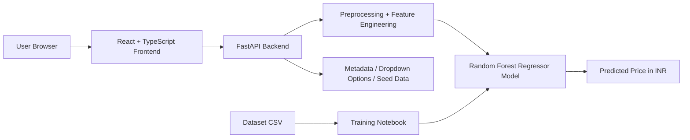
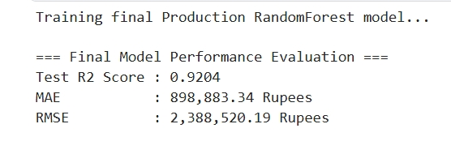
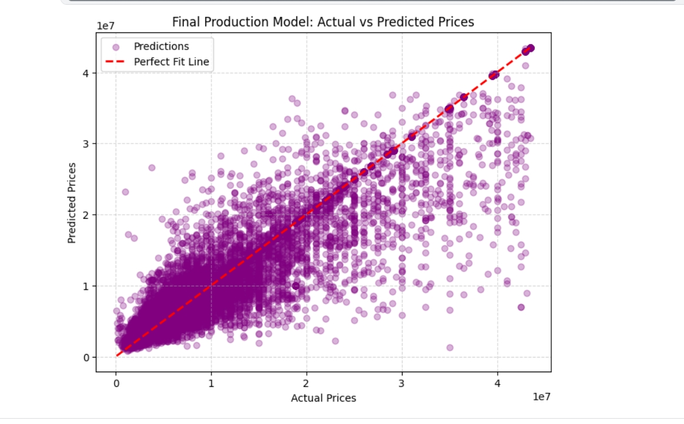
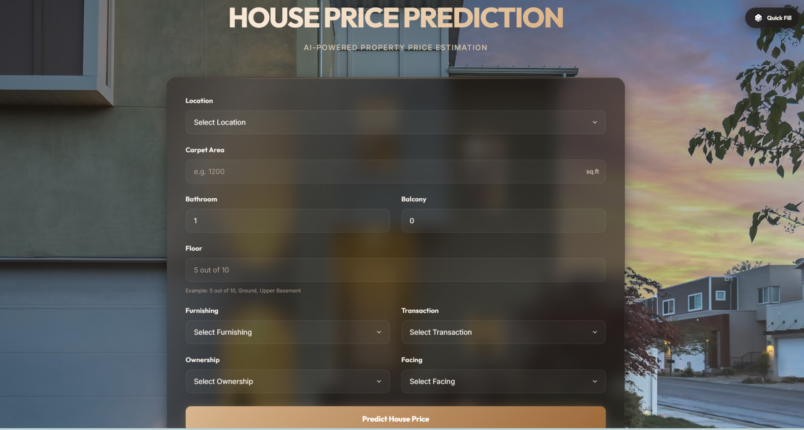
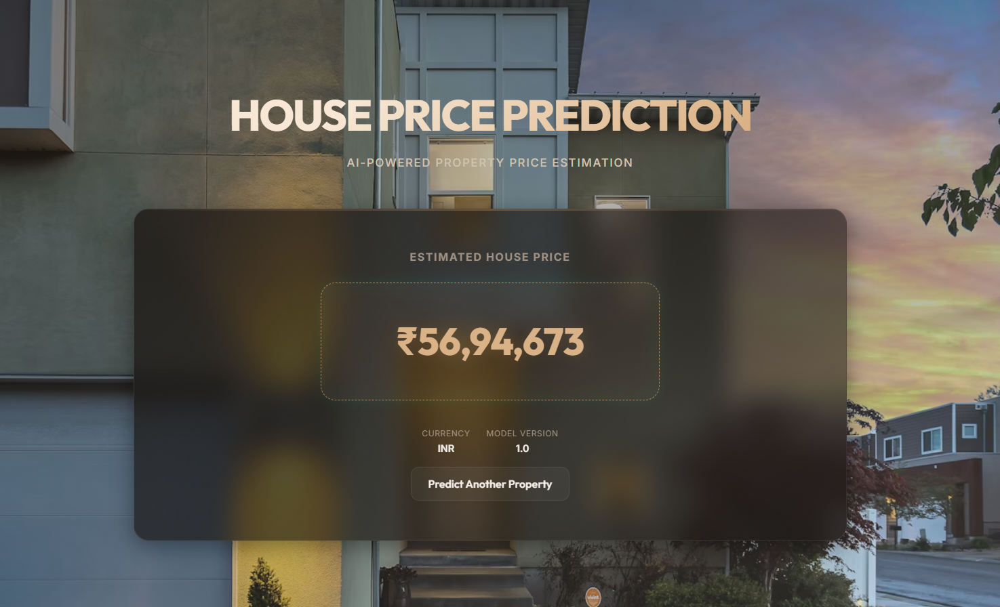
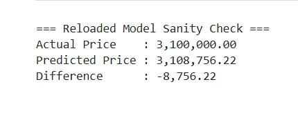

# House Price Prediction

A full-stack machine learning application for residential house-price estimation using a trained Random Forest regression model, a FastAPI backend, and a React + TypeScript frontend.

The project is designed as an educational ML deployment project: the complete model-training workflow is documented in the training notebook, while the final trained model artifact is kept outside source control and placed locally in the backend model directory when the application is run.

---

## 1. Project Overview

The application allows a user to enter property characteristics and receive an estimated house price in Indian Rupees (INR).

The user provides:

- Location
- Carpet Area
- Bathroom count
- Balcony count
- Floor
- Furnishing
- Transaction type
- Ownership
- Facing

The system then:

1. Validates the request.
2. Applies preprocessing and feature-engineering logic.
3. Loads the trained Random Forest model.
4. Performs inference.
5. Returns the predicted price.
6. Displays the result in the React frontend.

### Important

The trained `.pkl` model is intentionally not included in this repository submission.

The repository contains the training notebook and the instructions needed to reproduce the model. After training, the generated artifact must be placed manually at:

```text
backend/models/house_price_production_rf.pkl
```

The backend loads this file at startup.

---

## 2. Architecture Diagram



---

## 3. Tech Stack

| Layer | Technology |
| --- | --- |
| Backend | Python, FastAPI, Pydantic, Joblib |
| Frontend | React, TypeScript, Vite |
| ML | Random Forest Regressor, scikit-learn |
| Data/Notebook | Pandas, NumPy, Jupyter Notebook |
| Testing | Pytest |

---

## 4. Project Structure

```text
House Price Prediction/
├── README.md
├── SETUP_GUIDE.md
├── .gitignore
├── backend/
│   ├── .env.example
│   ├── README.md
│   ├── requirements.txt
│   ├── run.py
│   ├── app/
│   │   ├── api/
│   │   │   └── routes/
│   │   │       └── prediction.py
│   │   ├── core/
│   │   │   └── config.py
│   │   ├── data/
│   │   │   └── seed_samples.json
│   │   ├── schemas/
│   │   │   └── prediction.py
│   │   ├── services/
│   │   │   ├── inference.py
│   │   │   └── preprocessing.py
│   │   ├── utils/
│   │   │   └── logging_config.py
│   │   └── main.py
│   ├── models/
│   │   ├── location_price_map.json
│   │   ├── model_defaults.json
│   │   ├── model_options.json
│   │   └── house_price_production_rf.pkl
│   └── tests/
│       └── test_prediction.py
├── docs/
│   ├── Notebook/
│   │   └── house-price-cleaning-eda-modeling.ipynb
│   └── screenshots/
│       ├── Model_score.jpeg
│       ├── chart.jpeg
│       ├── pred_result.jpeg
│       ├── screen-2.png
│       └── scren-1.png
├── frontend/
│   ├── .env.example
│   ├── package.json
│   ├── vite.config.ts
│   ├── index.html
│   ├── public/
│   └── src/
│       ├── api/
│       │   └── predictionClient.ts
│       ├── components/
│       │   └── PredictionForm.tsx
│       ├── pages/
│       │   ├── HomePage.tsx
│       │   ├── ResultPage.tsx
│       │   └── NotFoundPage.tsx
│       ├── types/
│       │   └── prediction.ts
│       ├── App.tsx
│       ├── index.css
│       └── main.tsx
└── SETUP_GUIDE.md
```

---

## 5. Dataset

The model is trained on a Bengaluru house-price dataset from Kaggle.

- Dataset link: https://www.kaggle.com/datasets/juhibhojani/house-price

### Download instructions

1. Create a Kaggle account and accept the dataset terms.
2. Open the dataset page linked above.
3. Download the dataset archive.
4. Extract the CSV file locally.
5. Use the extracted file in the training notebook to reproduce or retrain the model.
6. Save the trained model artifact as:

```text
backend/models/house_price_production_rf.pkl
```

> The training notebook is available in `docs/Notebook/house-price-cleaning-eda-modeling.ipynb`.

---

## 6. Model Metrics

The chosen production model is a Random Forest regressor.

| Metric | Value |
| --- | --- |
| MAE | ₹989,883.34 |
| RMSE | ₹2,388,520.19 |
| R² Score | 0.9204 |





These metrics reflect the model version used in this project and were obtained during evaluation on the project dataset.

---

## 7. Screenshots







---

## 8. Setup Guide

For full local setup instructions, including clone, environment variables, backend startup, frontend startup, and API testing, see [SETUP_GUIDE.md](./SETUP_GUIDE.md).

---

## 9. Notes

- The trained model file is intentionally not committed to the repository because it is large.
- The backend loads the model artifact at startup.
- The frontend obtains dropdown options from the backend `/options` endpoint.
- Quick-fill sample data is available via the `/seed` endpoint.
